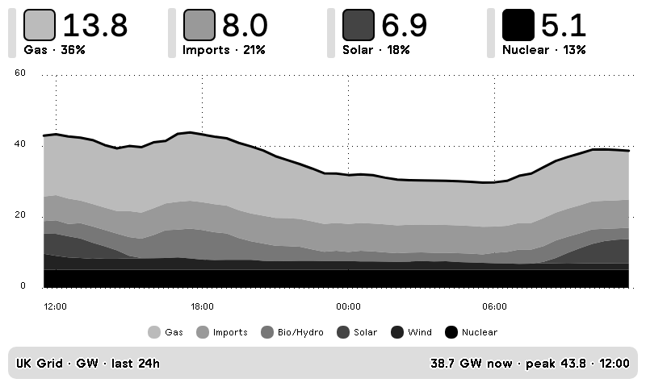
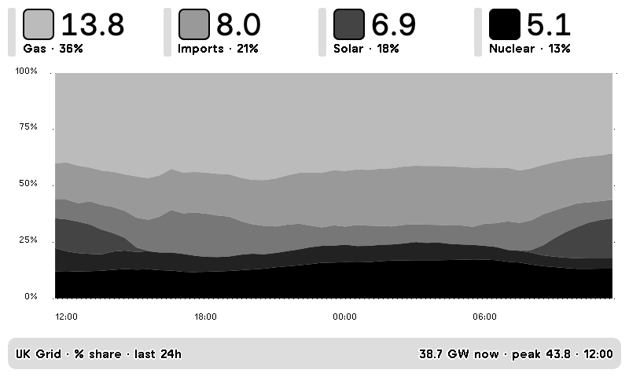
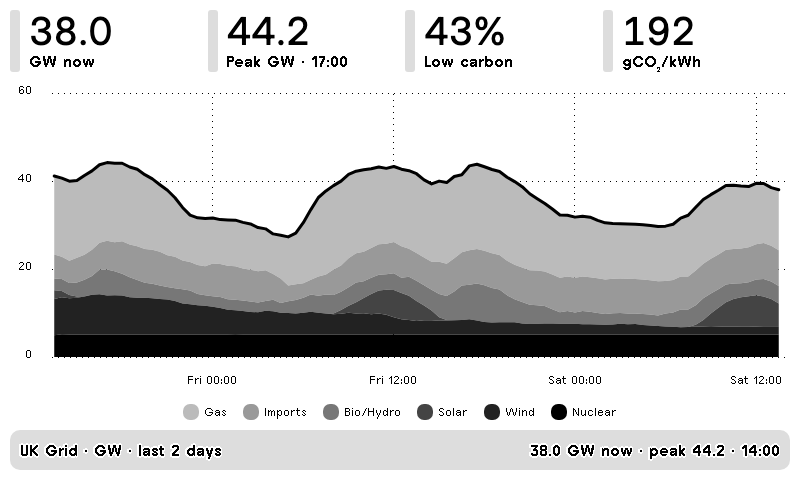
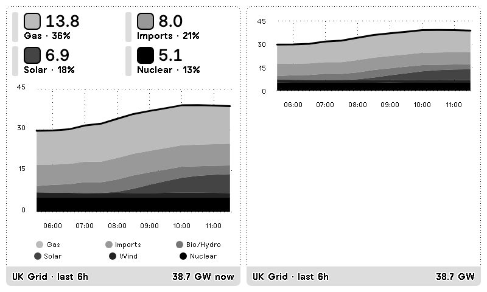

# What's Powering Britain

A [TRMNL](https://trmnl.com) private plugin that charts Great Britain's electricity generation by source: gas, imports, bio/hydro, solar, wind and nuclear. It's a stacked area chart with a line for total demand on top.



It uses free public data and needs no API key or server.

## Setup

1. On trmnl.com go to **Plugins → Private Plugin → New** and set Strategy to **Polling**.
2. **Form Fields**: paste [`src/settings.yml`](src/settings.yml).
3. **Polling URL(s)**: paste [`src/polling_urls.liquid`](src/polling_urls.liquid) as it is. Click **Parse** to check the dates come out like `2026-11-20T10:00:00Z`.
4. Save, open **Edit Markup**, and paste each file into its tab:

   | File | Tab |
   |------|-----|
   | `src/shared.liquid` | Shared |
   | `src/full.liquid` | Full |
   | `src/half_horizontal.liquid` | Half Horizontal |
   | `src/half_vertical.liquid` | Half Vertical |
   | `src/quadrant.liquid` | Quadrant |

5. Click **Force Refresh**. A 30-minute refresh rate matches how often the data updates.

## Settings

| Setting | Options |
|---------|---------|
| Time window | 6h, 12h, 24h, 2 days (the quadrant layout shows at most 12h) |
| Header | Top 4 sources right now, or summary (GW now, peak, low-carbon %, gCO₂/kWh) |
| Chart units | GW with a total line, or % share |
| Show legend | Yes / No |

| % share | 2 days + summary | Half-size layouts, 6h |
|---|---|---|
|  |  |  |

## Data

- [Elexon BMRS](https://bmrs.elexon.co.uk/): half-hourly generation by fuel type, measured at transmission level
- [Sheffield Solar PV_Live](https://www.solar.sheffield.ac.uk/pvlive/): national solar output, which Elexon doesn't see because it's embedded in local distribution networks
- [Carbon Intensity API](https://carbonintensity.org.uk/): gCO₂/kWh

Elexon is requested in 26-hour chunks (one URL per chunk, two for the 2-day window). Below 24 hours Elexon switches to 5-minute rows, which is too big. Chunks of 24 hours or more come back half-hourly at about 40 kB each. TRMNL caps the total of all polled responses at 100 kB, which is why 2 days (about 77 kB) is the longest window.

PV_Live publishes up to an hour behind Elexon, so the chart ends at the latest half-hour that has a solar figure. Net exports on the interconnectors are drawn as zero imports.

## Local preview

```sh
python3 preview/build.py --hours 48 --header summary --units percent --legend no
open preview/out/full.html
```

The script fetches live data, fills in the templates and loads TRMNL's real CSS, JS and Highcharts. The flags stand in for the form fields.
